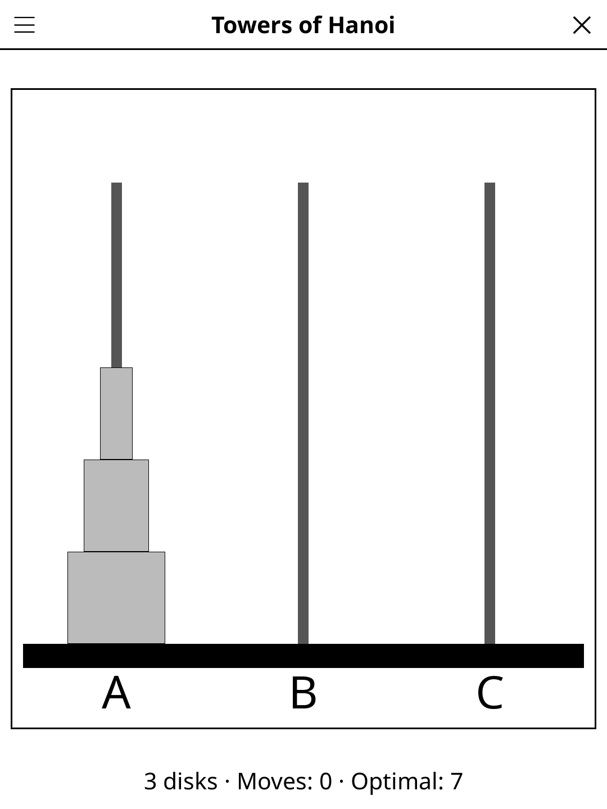

# Hanoi — KOReader Plugin

> Move all disks from the first peg to the third, never placing a larger disk on a smaller one.

## Screenshot

## Rules

Move all disks from the first peg to the last. Only one disk at a time. A larger disk may never rest on top of a smaller disk. The minimum solution for N disks takes 2ᴺ − 1 moves.

## Rules

- Three pegs and a stack of disks of different sizes, all starting on the left peg.
- Only the top disk of any peg may be moved.
- A larger disk may never be placed on top of a smaller disk.
- Move all disks to the rightmost peg to win.
- The minimum number of moves is 2^n − 1 (e.g. 7 for 3 disks).

## Features

- Moves counter against the minimum 2ⁿ − 1.
- **Perfect solves** — a win in exactly 2ⁿ − 1 moves is announced as the
  minimum, and the *Size* menu shows ★ next to every disk count you've
  solved perfectly.

## Controls

| Action | Control |
|--------|---------|
| Select a source peg | Tap a peg with disks |
| Move the selected disk | Tap the destination peg |
| Deselect | Tap the same peg again |
| New game | Tap **New** |
| Change disk count | Tap the disk-count button |
| Show rules | Tap **Rules** |

## Settings

Disk count can be set to 3, 4 or 5. Each extra disk doubles the minimum number of moves.

## License

GPL-3.0
